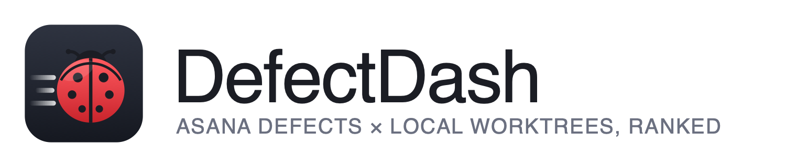

<p align="center"></p>

# DefectDash

A small native macOS window that joins the open defects in one Asana section
with the git worktrees on your disk, ranks them by urgency, and flags the
ones where the other side has replied since you last acted.

Asana is read-only: the app only ever sends `GET` requests. Git is read with
`rev-parse`, `log`, `status`, `rev-list`, `config` and `submodule foreach`.
Nothing is written to either.

## What it expects

Every name below is a setting ("Board vocabulary" in the Settings sheet);
the values in brackets are the defaults.

- An Asana section whose open tasks are the defects, with the ticket id in
  the task name as `<prefix>-NNN` (`BUG`).
- Optional custom fields on those tasks:
  - a status field (`Status`) whose options start with a number
    (`1 · Open` … `5 · Closed`). Higher numbers rank first; numbers at or
    above the "closed from" value (`5`) are closed-on-the-board; the
    "retest" number (`4`) is the one where a "retest" comment raises the
    RETEST tag and a move back from it raises BOUNCED.
  - an "awaiting" field (`Awaiting`) with one option for your side and one
    for the other side; you name both labels.
  - a classification field (`Classification`) whose value
    `Expected Behaviour` raises the EXPECTED BEHAVIOUR tag.
  - a sprint field, matched as a name suffix (`Sprint`).
  - optionally, a regex for comments relayed from another tracker, with
    group 1 capturing the real author (off by default).
- Task notes in a bug-report form layout with headings such as
  `Expected result::`, `Actual result::`, `Steps to reproduce::`,
  `Environment::`, `Priority:`; common variants (`Expected behaviour`,
  `Observed`, `Repro steps`, `Severity`, `Reported by`, …) are accepted.
  Anything else is shown raw.
- A worktrees root (default `~/src/wtrees`) laid out as
  `<root>/<System>/<anything>/...`, where a directory containing `.git` is a
  worktree. Worktrees are matched to defects by `bug-NNN` in the directory
  path or branch name (`fix/bug-101`, `bug-013/foo`, `fix-bug-004`, …).

## Requirements

- macOS 15 or later, Xcode 27 command-line toolchain (Swift 6.4).
- No third-party packages.

## Install

### Homebrew

```sh
brew tap arawn-davies/defectdash
brew trust --cask arawn-davies/defectdash/defectdash   # Homebrew 6 tap trust; or `brew trust arawn-davies/defectdash` for the whole tap
brew install --cask arawn-davies/defectdash/defectdash
```

Installs `DefectDash.app` into Applications and the `defectdash` terminal UI
onto your path, and clears the quarantine flag on both (the build is ad-hoc
signed, not notarized). If Gatekeeper still refuses the terminal binary, the
real file lives in the Caskroom, not behind the `bin` symlink:

```sh
xattr -d com.apple.quarantine "$(brew --prefix)/Caskroom/defectdash/$(brew list --cask --versions defectdash | cut -d' ' -f2)/defectdash"
```

`brew upgrade --cask defectdash` updates both.

### Manual

Download `DefectDash-<version>-macos-arm64.zip` from the
[releases page](https://github.com/Arawn-Davies/DefectDash/releases). It
contains the app and the `defectdash` binary:

```sh
unzip -q ~/Downloads/DefectDash-*-macos-arm64.zip -d ~/Downloads/DefectDash
cp -R ~/Downloads/DefectDash/DefectDash.app /Applications/
xattr -dr com.apple.quarantine /Applications/DefectDash.app
xattr -d com.apple.quarantine ~/Downloads/DefectDash/defectdash
install -m 755 ~/Downloads/DefectDash/defectdash /usr/local/bin/defectdash
open /Applications/DefectDash.app
```

On first launch the Settings sheet opens: paste your Asana token, set the
section gid and board vocabulary (below), save. macOS asks once whether the
app may read the token from the Keychain; choose **Always Allow**.

## Build and run

```sh
make test        # unit tests for DefectDashCore
make app         # release build, assembles and signs build/DefectDash.app
make run         # make app, then open the bundle
```

## One-time setup

### 1. Code-signing certificate (recommended)

Ad-hoc signatures change on every build, so the Keychain would ask for
permission to read the Asana token after each rebuild. A self-signed
certificate gives the app a stable identity:

1. Open **Keychain Access** → menu **Keychain Access → Certificate Assistant →
   Create a Certificate…**
2. Name: `DefectDash Dev`. Identity Type: **Self Signed Root**.
   Certificate Type: **Code Signing**. Create.
3. In Keychain Access, find the certificate under *login → My Certificates*,
   open it, expand **Trust**, and set **Code Signing** to **Always Trust**.

`make app` picks the identity up automatically (override with
`SIGN_IDENTITY=... make app`). Without it the build still works, ad-hoc
signed, with a warning.

### 2. Asana personal access token

Either paste the token into **Settings** inside the app (it opens on first
launch), or put it in a file and let the app import it:

```sh
make app
make import-pat PAT_FILE=~/asana-token.txt
```

The binary reads the file itself and stores the token in the login Keychain
(service `io.github.arawn-davies.defectdash`, account `asana-pat`). The token
is never printed, logged or written anywhere else, and it is not part of
this repository.

### 3. Settings

Gear icon in the toolbar (or the menu-bar item):

- Asana token (**Test** calls `/users/me` and shows your name).
- Section gid of the defects list, and optionally the project gid.
- Board vocabulary: ticket prefix, field names, status numbers, the two
  "awaiting" labels, the optional relay regex (see above).
- Worktrees root and, optionally, which systems may match defects
  (empty = all).
- Refresh interval in minutes (1–30, default 5).

## Groups

1. **Needs you** — awaiting your side and the other side has acted since
   your last Asana action or last commit on the matched worktree.
2. **Yours, in hand** — assigned to you, nothing new from the other side.
3. **Unassigned, on our side**
4. **Someone else's** (dimmed)
5. **With the other side** (dimmed)
6. **Closed on the board, still open in Asana** (dimmed)

Tags: `RETEST`, `EXPECTED BEHAVIOUR`, `OVERDUE`, `BOUNCED`, `NO WORKTREE`,
`NEEDS YOU`. Below the groups, "Other worktrees" lists dirty or unpushed
worktrees that matched no defect.

## Terminal UI

`defectdash` shows the same ranked list in any terminal (kitty, iTerm2,
Terminal.app, or over SSH), with no GPU involvement:

```sh
make tui                     # builds build/defectdash
make install-tui             # installs to /usr/local/bin (PREFIX=~/.local for ~/.local/bin)
defectdash
```

It reads the same settings as the app (defaults domain
`io.github.arawn-davies.defectdash`) and the same Keychain token. When the
login keychain is locked, as it usually is over SSH, set `ASANA_PAT` in the
environment or pass `--token-file <path>`.

Layout: grouped list on the left, detail on the right, status and key hints
at the bottom. Keys: `j`/`k` move, `Enter` focuses the detail, `J`/`K` or
PgUp/PgDn scroll it, `1`–`6` jump to a group, `/` filter, `d` toggle dimmed
groups, `O` show other worktrees, `r` refresh, `o` open in Asana, `f` reveal
in Finder, `t` open in the configured terminal, `c` copy the worktree path,
`z` zoom the focused pane to full width, `y` copy the detail text, `?` help,
`q` quit. `o`/`f`/`t`/`c`/`y` act on the machine running `defectdash`.

Selecting text with the mouse in a two-pane layout grabs whole rows across
both panes, because terminal selection is row-based. Press `z` to zoom the
pane you want and select from that, press `y` to copy the whole detail to the
clipboard, or use your terminal's rectangular selection (Option-drag in kitty,
iTerm2 and Terminal.app).

## Startup cache

The last successful refresh is written to
`~/Library/Caches/io.github.arawn-davies.defectdash/last-refresh.json` (mode
0600, no token). Both the app and `defectdash` show it immediately on launch,
marked "cached", and replace it as soon as the first live refresh finishes.
Delete the file to start cold.

## Icon and logo

`assets/icon.svg` and `assets/logo.svg` are the sources; `scripts/make-icon.sh`
re-renders `AppIcon.icns` and the PNGs with stock macOS tools.

## Diagnostics

`build/DefectDash.app/Contents/MacOS/DefectDash --once` runs one refresh
headlessly and prints the groups, matches, tags and per-phase timings.
